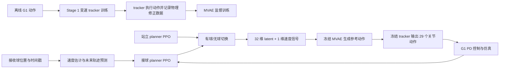

# G1 乒乓球 AdaPT 框架

实现位置：`src/mjlab/tasks/g1_adapt/`；分支：`adapt-g1-pingpong`。
这是按论文接球路线搭建的 G1 迁移实现，包含从动作数据到推理的训练链路。
目前通过流程验证，未完成收敛训练，不代表已获得可部署的打球技能。

2026-11-02 起，G1 全链路使用 `g1_29dof_pingpong_fast_extended_27mm.urdf` 的独立转换资产。
关节及观测维度保持不变；拍面中心、碰撞体、球拍网格及惯量已同步更新。
下文 2026-10-30 的短训练结果属于之前的资产版本。

## 完整训练流水线

`scripts/train_g1_adapt_full.py` 从头依次运行 Stage 1、物理修正与筛选、MVAE、
接球 planner、站立 planner、200 球评估及固定速度消融，最后导出模型包。
默认使用 GPU 0、1024 个并行环境；训练长度分别为 30000 次更新、100 epochs、
30000 次更新和 10000 次更新。每 1000 次 PPO 更新保存一次，阶段失败立即停止。

```bash
uv run python scripts/train_g1_adapt_full.py --gpu 0 --num-envs 1024
```

每次运行在 `logs/g1_adapt_full/` 下创建独立目录，复制源码、URDF/MJCF/网格及动作数据。
子进程仅使用该快照；`provenance.json` 记录文件哈希，`status.json` 记录阶段、进程和进度。
各阶段输出保存在对应日志中；PPO 权重位于 `work/logs/rsl_rl/`，完成后模型包位于 `bundle/`。
任务启动后需要等待完整训练完成，启动成功本身不代表技能收敛。

若 Tracker、修正数据和 MVAE 均完成，而接球 planner 在保存首个 checkpoint 前
启动失败，可以降低环境数后继续，复用原快照和前述三阶段的产物：

```bash
uv run python scripts/train_g1_adapt_full.py --gpu 0 --num-envs 1024 \
  --resume-run logs/g1_adapt_full/<原运行目录>
```

恢复会核对快照哈希、保留原训练迭代数，并归档旧状态和失败日志。
该选项暂不支持已有 planner checkpoint 的中途续训，避免意外丢弃训练进度。

组件性能评估使用 `scripts/evaluate_g1_components.py`。将 `PYTHONPATH` 指向该次
运行的 `snapshot/src` 和 `snapshot/src/rsl_rl_lib` 后执行：

```bash
uv run python scripts/evaluate_g1_components.py \
  --run logs/g1_adapt_full/<运行目录> --output /tmp/g1-component-validation
```

评估输出各条件逐动作记录和汇总 JSON；包括 43 条原始动作的固定/随机变速、
三组观测噪声随机种子、击球标记帧附近精度、MVAE 原始整段留出集预测、
5 秒自由生成，以及固定 latent 或随机 latent 驱动的物理跟踪。
固定速度为 0.5/1/1.5/2 倍；生成动作闭环和原动作播完后保持末帧的 5 秒对照
使用 0.5/1/2 倍。组件仿真关闭自动重置并记录首次摔倒时间，不放置球桌或来球。
原始动作均参加过 Tracker 训练；MVAE 留出动作仅对 MVAE 属于未见数据。
无 Planner 的固定/随机 latent 是组件测试，不能直接等同于已训练 Planner 的击球表现。

## 第一轮后自动接续第二轮

`scripts/supervise_g1_adapt.py` 是独立后台进程，等待第一轮完整流水线结束后，
串行评估单独 Rally、Rally/Standing 按球状态切换、固定速度消融和 8 秒 Standing。
摔倒率读取自动重置前保存的 termination 标志。每组来球试验 200 次，站立 64 次。
它按以下工程阈值选择已实现的第二轮训练设置，并写入 `decision.json` 和
`round2_profile.json`；这是确定性指标规则，不是后台持续运行的语言模型会话。

| 证据 | 第二轮调整 |
| --- | --- |
| 1× 击球帧拍面中心平均误差 > 5 cm | 增加实际拍面中心/法向奖励，Tracker 训练 45000 次 |
| 无 Planner、1×、5 秒生成闭环摔倒比例 > 10% | MVAE rollout 32 帧、200 epochs，加小权重关节速度一致性损失 |
| 最终层级策略有效落台率 < 50% | 加强落台奖励、移除向前球速奖励，Rally 训练 45000 次 |
| 最终层级策略或站立摔倒率 > 5% | 限制 latent 到 ±2、加强平衡与摔倒惩罚，Standing 训练 15000 次 |
| 固定速度使落台率提高或摔倒率降低超过 5 个百分点 | 将速度范围收窄到 0.75～1.5 |

第二轮从头训练全部四个模型，原始动作与 extended-27mm 资产保持一致。
Tracker 使用 4096 环境，两个 Planner 使用 1024 环境；未触发增量预算时仍采用
30000/30000/10000 次 PPO 更新。MVAE 未触发长时问题时采用 16 帧、100 epochs。
MVAE 固定整段留出窗口用于跨 epoch 比较，并分别保存 `last.pt`、`best.pt`、
每 10 个 epoch 的 checkpoint，`mvae.pt` 选择验证最佳权重。
击球/过网奖励改为事件奖励，避免在事件已经发生后每个控制步重复给分。

守护进程和第二轮流水线使用 `/tmp/adapt-g1-gpu0.lock` 防止本项目重复启动，
每 15 秒检查阶段和 GPU 计算进程；阶段启动前若发现外部 CUDA 进程则等待。
这属于协作式锁，无法阻止不遵守锁的外部程序；驱动级独占需要管理员权限。
后台进程无终端依赖；关闭聊天窗口后继续工作，服务器重启后不自动恢复。
第一轮、第二轮、最终评估、源码快照和决策记录均放在独立目录中。

2026-11-04 用户允许外部任务在 GPU 0 保留少量占用。当前后台服务设置
`ADAPT_G1_ALLOW_GPU_SHARING=1`，各阶段及最终评估不再等待外部 CUDA 进程退出，
仍保留任务锁和进程监测。第二轮从已完成的 45000 次 Tracker 后接续，跳过已完成阶段。

## 依据与范围

优先依据 [AdaPT 论文 §3.1–3.5、附录 A/B](https://arxiv.org/html/2608.20087v1)。
核心对应关系是：变速 tracker → 修正动作 → MVAE → 输出 latent 和速度的 planner；
变速后的状态反馈给下一次生成。站立另外学习一个高层策略。
[官方仓库](https://github.com/noitom-robotics/AdaPT) 公开的是第一阶段发球跟踪训练，
因此这里没有把未公开的接球代码或超参数当作已知实现。

对论文引用的实现进行了代码核对：

| 来源 | 核对版本/文件 | 使用方式 |
| --- | --- | --- |
| [Vid2Player3D](https://github.com/nv-tlabs/vid2player3d) | `5408ca079833b643c44956f1e848f4e19349a8ce`；`vid2player/motion_vae/model.py`、`vid2player/env/tasks/physics_mvae_controller.py` | 参考条件 MVAE、MoE decoder、latent 控制结构；没有复制 NVIDIA 源码或模型 |
| [Character Motion VAEs](https://github.com/electronicarts/character-motion-vaes) | `3417d5b7a897d0cb222218d3bb320e76e8119274`；`vae_motion/models.py`、`vae_motion/train_mvae.py` | 参考混合专家和自回归训练思路；这里为 G1 tensor 重新实现 |
| [AdaMimic](https://github.com/InternRobotics/AdaMimic) | 原项目发球 residual 思路 | 仅用于区分发球路线；本次没有加入发球 residual 或抛球任务 |

原始网球 `adapt_tennis/` 保持官方提交
`615b42f8edf8d78b1c8a9601673c70ea67e45ee9` 的文件内容。
新模块只复用独立 `g1_stage1/` 与公共 mjlab，不导入原网球或已删除的 A3。

## 组成及哪些需要训练



需要训练四个模型：tracker、MVAE、rally planner、standing planner。
物理修正是 tracker rollout，不是第五个模型。FK、球物理、轨迹预测、
位置观测估计和切换规则没有可训练参数。

planner 的“动作控制信号”就是 **32 维 MVAE latent `z`**，并不直接指定拍面位置或关节。
第 33 维动作映射成速度倍率 `alpha∈[0.5,2]`，0 对应正常速度 1。
只有 tracker 输出 29 维关节动作，再由原有 PD 执行。

## 实现文件

| 文件 | 职责 |
| --- | --- |
| `correct_motions.py` | 使用指定的新 tracker 运行原动作、记录执行状态；按姿态、关节和腕部误差过滤 |
| `motion.py`、`data.py` | 72 维状态、旋转转换、原生 G1 FK、clip 级切分和语义标签 |
| `mvae.py`、`train_mvae.py` | 条件后验、32 维高斯 latent、MoE decoder、KL/重建/辅助分类、多步自回归训练 |
| `generator.py`、`reference.py` | 在线生成、变速混合、关节限位、FK、参考速度计算和历史反馈 |
| `actions.py` | planner 输出 → MVAE → 132 维 tracker 观测 → 冻结 JIT tracker |
| `ball.py` | 独立合法来球、球飞行/桌面反弹/实际拍面接触、位置观测、速度估计和轨迹预测 |
| `env_cfg.py`、`terms.py` | 接球/站立任务、PPO 奖励、物理跌倒终止 |
| `runner.py` | 冻结依赖快照与哈希、推理参数记录、planner JIT 导出 |
| `evaluate.py` | 新 seed 来球，统计接触、过网、落台、跌倒等；支持固定速度消融 |
| `export.py`、`runtime.py` | 配对模型包、哈希检查、统一分层推理和有球/无球切换 |

MVAE 状态为根部线速度 3、角速度 3、旋转 6、关节角 29、关节速度 29、击球相位 2。
不包含绝对根位置；击球帧相位为 π。训练做 ±15° yaw 增广，按完整 clip 分割验证集，
从 teacher forcing 逐渐切换为自回归。未知 spin 标签被屏蔽，不会把无标签数据当作平击。
当前原始数据为 43 段 Tele-GMR NPZ，50 Hz，有正/反手和击球时刻，缺少旋转标签。

控制周期固定 0.02 s，物理步长 0.005 s。默认 actor 309 维，tracker 输入 132 维；
MVAE 历史长度/预测步数改变时上层维度相应变化。tracker 的旋转 6 维展平顺序与
MVAE 状态不同，两处已显式处理，并通过真实仿真观测对照测试。

## 训练顺序

以下命令均在当前仓库根目录执行；先按仓库说明安装依赖（`uv sync`）。
NPZ、修正数据和权重不通过 Git 同步。其他机器需单独准备数据。

### 1. 从头训练变速 tracker

不依赖 MVAE，也不需要旧 Stage 1 checkpoint：

```bash
uv run train Mjlab-G1-PingPong-Stage1 \
  --gpu-ids '[0]' --env.scene.num-envs 4096 \
  --agent.resume False --agent.max-iterations 30000 \
  --agent.run-name g1_stage1_fresh
```

训练时长只是起点，应先检查动作跟踪和站立稳定性。详见 [G1_STAGE1.md](G1_STAGE1.md)。
选定新模型的 JIT，而非训练 checkpoint 文件：

```bash
export ADAPT_G1_TRACKER=/absolute/path/to/new/run/jit/modeljit_N.pt
```

### 2. 生成物理修正数据

```bash
uv run python -m mjlab.tasks.g1_adapt.correct_motions \
  --tracker "$ADAPT_G1_TRACKER" \
  --motion-directory dataset/g1_stage1/motions \
  --output-directory dataset/g1_adapt_corrected/motions
```

要求输出目录为空，避免重跑时残留上次通过筛选的文件。记录 29 个关节和完整 body 状态，
保留原语义标签。默认整段任一时刻根高度误差 >0.25 m、倾倒、关节 RMS >0.5 rad
或腕部误差 >0.3 m 即剔除；阈值可配置。manifest 记录输入和 tracker 哈希、接受情况和误差。
少于两段通过时明确失败，应改善 tracker/数据。不能靠放宽阈值证明训练质量。

### 3. 训练 MVAE

```bash
uv run python -m mjlab.tasks.g1_adapt.train_mvae \
  --motion-directory dataset/g1_adapt_corrected/motions \
  --output artifacts/g1_adapt/mvae.pt --device cuda:0
```

默认要求 NPZ 中有物理修正标记；`--require-corrected False` 只用于原始数据实验。
可用 JSON 补充标签：以 NPZ stem 为键，值为
`{"stroke":"forehand","spin":"topspin","strike_frame":43}`。
标签映射采用正/反手，以及非 slice/slice；乒乓球上/下/侧旋尚未建立完整分类。
归一化仅使用训练 clips。checkpoint 和 JSON 保存训练/验证 clip 哈希及 prior rollout MSE。
验证 MSE 是短窗口、零 latent 指标，不能代替长时间多样性与物理可跟踪性评估。

### 4. 冻结 tracker/MVAE，分别训练两个 planner

```bash
export ADAPT_G1_MVAE="$(pwd)/artifacts/g1_adapt/mvae.pt"
export ADAPT_G1_MOTION_DIR="$(pwd)/dataset/g1_adapt_corrected/motions"

uv run train Mjlab-G1-AdaPT-Rally \
  --gpu-ids '[0]' --env.scene.num-envs 1024 \
  --agent.resume False --agent.max-iterations 30000

uv run train Mjlab-G1-AdaPT-Standing \
  --gpu-ids '[0]' --env.scene.num-envs 1024 \
  --agent.resume False --agent.max-iterations 10000
```

环境启动即校验依赖是否存在及 latent 维度是否匹配。NPZ 此阶段只用于初始化，
控制期间参考完全由 MVAE 在线产生。变速后的状态进入下一步自回归历史。
来球由独立物理几何采样，不读取动作、击球帧或参考拍位置。
接触计算使用实际机器人手腕的拍面运动；要求来球已在己方台面反弹一次，
提前截击、二次触球、触网和落点由任务逻辑判定。

actor 读取带噪声、0–2 步延迟及丢帧的位置观测形成的估计，不能直接读取真值球速。
critic 允许额外球真值。预测包含重力、二次阻力和桌面反弹。
PPO 奖励包含击球相位加权接近、碰拍、过网、落点、向前速度，及二次触球、
倾倒/背向、latent/速度幅度惩罚。站立策略学习初始姿态和位置保持。
这些权重是本实现初值，需要随真实技能训练调节。

### 5. 评估与固定速度消融

```bash
uv run python -m mjlab.tasks.g1_adapt.evaluate \
  --checkpoint /absolute/path/to/rally/run/model_N.pt \
  --episodes 200 --seed 10001 --output artifacts/g1_adapt/eval.json

uv run python -m mjlab.tasks.g1_adapt.evaluate \
  --checkpoint /absolute/path/to/rally/run/model_N.pt \
  --episodes 200 --seed 10001 --fixed-speed True \
  --output artifacts/g1_adapt/eval_fixed_speed.json
```

统计每次独立来球的接触/过网/落台/跌倒和最小拍球距离。
这里每球重置机器人，**不是连续多板回合指标**。固定速度是推理时令 alpha=1，
不等于重新训练无变速基线；相同 seed 保持相同采样分布，不保证两组逐球配对。

### 6. 导出和推理

```bash
uv run python -m mjlab.tasks.g1_adapt.export \
  --rally-checkpoint /absolute/path/to/rally/run/model_N.pt \
  --standing-checkpoint /absolute/path/to/standing/run/model_M.pt \
  --ready-motion dataset/g1_adapt_corrected/motions/0623_kjp-006.npz \
  --output artifacts/g1_adapt/bundle
```

ready-motion 应选实际通过筛选、与部署初始姿态一致的文件，上述文件名仅示例。
两个 planner 必须使用相同 tracker、MVAE 和推理配置；导出同时验证哈希及输出形状。
模型包包含两个 planner JIT、tracker JIT、MVAE、初始状态和 `bundle.json`。
保存的实际训练参数包含关节顺序/缩放、控制周期、速度边界及球物理参数，避免部署时硬编码。

`runtime.HierarchicalController.step()` 接收 `RobotState`、球位置和时间戳，
输出 29 个关节目标。`joint_positions` 是带 encoder bias 的编码器读数；
姿态 WXYZ、角速度机体坐标、位置统一世界坐标。时间戳使用同一时基的相对秒，
不要直接传 Unix epoch 秒或纳秒整数；延迟包另传 `measurement_timestamp`。
重复/倒序包被丢弃；至少两帧有效且最近数据年龄 <0.15 s 才切接球策略，否则用站立策略。
速度边界、生成器和观测构造与训练共用；切换不重置生成器。
当前没有 SDK、DDS、电机/相机 IO、根部状态估计、实时调度或机器人安全状态机。

## 仍有的问题及与原网球的差异

1. **不是官方未开源代码的精确复现。** MVAE 宽度/专家数、latent 32、观测压缩、
   PPO 奖励权重、站立奖励和采样范围是迁移选择；无作者完整配置，不能宣称一致。
2. **动作库规模与覆盖有限。** 仅 43 段短乒乓球动作，缺少连续步法和恢复动作。
   多步生成可能漂移、模式塌缩或遗忘相位；tracker 训练分布与 MVAE 生成分布也可能不一致。
3. **物理修正尚需合格 tracker。** 两次 PPO 更新的模型不能生成合格训练集。
   筛选只是一层质量门槛；保留的击球时刻标签可能因执行滞后不再准确，需要重新标注。
4. **没有完整旋转控制。** 缺少 spin 标签，辅助 spin head 的损失被屏蔽；
   尚未加入论文式旋转选择奖励，也没有 Magnus、拍面切向摩擦或乒乓球侧旋模型。
5. **球为解析近似。** 球与机器人没有 MuJoCo 双向接触力；拍面为有限圆盘，
   使用扫掠接触和局部法向近似。拍厚、转拍产生的局部切向速度、台边、网回弹未精确建模。
   阻力 0.12、反弹/摩擦系数和拍半径为待标定初值。机器人自碰撞仍沿用资产的关闭设置，
   没有论文自碰撞惩罚。原生桌面会与机器人碰撞，但球只走解析模型。
6. **落点奖励的稀疏性不同。** 当前记录真实仿真落台事件，未用论文的击球后虚拟 rollout
   提前给予落点奖励；强稀疏奖励可能使接球 planner 学习缓慢，需先确认接近奖励与动作覆盖。
7. **感知和部署并未复现。** 当前是位置窗口拟合速度和物理前推，没有实现论文的相机链路、
   专门反弹识别/分段估计或实机辨识。跨反弹拟合会短时估错速度，未来预测也不考虑球网阻挡。
8. **连续回合尚未验证。** 训练是独立发球机来球且每球 reset，运行时切换站立只验证了接口。
   自动连续来球、回位、相机短暂丢失时的切换抖动，需要持续仿真和实机数据验证。
   当前落点目标固定在对方台面中心附近，不能据此声称策略能泛化到任意目标落点。
9. **没有新增发球分支。** 此处实现接球/待机路线。论文发球的 residual tracker、抛球、
   释放时序和手部控制未迁移；原始网球实现作为参考完整保留。
10. **推理工程还未定型。** Python/Torch FK 与物理前推的 50 Hz 延迟和抖动尚无硬实时保证。
    生成状态有硬关节限位和根速度限幅，这会改变原始 decoder 分布，需评估极限动作的失真。

## 验证范围

2026-10-30 在 RTX 4090 上做流程验证：

- MVAE：2 epochs、每轮 2 batches、多步反向传播、保存/重载通过。
- rally 和 standing：各 8 environments、2 次 PPO 更新，checkpoint/JIT 导出通过。
- 新增任务注册后，Stage 1 另做 8 environments、2 次更新的从头训练回归，通过；不加载旧模型。
- 真实 MuJoCo/Warp 状态对照：132 维 tracker、309 维 planner 观测和最终关节目标一致，
  包含非零 encoder bias；过期观测切换站立通过。
- 新 seed 的 8 球评估流程通过；短训练模型 0 次碰拍/成功，不构成技能性能验证。
- 物理修正真实 rollout：短训练 tracker 的 2 段均被质量门槛拒绝，按预期终止，未伪造合格数据。
- 28 项针对性测试通过，覆盖 FK/旋转、MVAE 梯度、反馈、球接触、反弹、观测估计、
  数据边界、依赖校验、Stage 1、任务注册以及真实仿真/推理一致性；新增模块 `ty` 检查通过。

临时验证产物在 `/tmp/g1-adapt-smoke/`，不作为正式训练模型，也不随 Git 提交。
原始网球目录、原网球数据/权重与官方基线的差异检查为空。
本机验证复用了邻近 `Adapt-TeleAI/.venv` 的依赖，通过 `PYTHONPATH` 指定当前分支的
`src` 和 `src/rsl_rl_lib`，执行的任务源码均来自当前目录。正式使用可在本目录独立 `uv sync`。

本次短训练记录：

- `logs/rsl_rl/g1_stage1/2026-10-30_16-59-04_adapt_framework_regression/`
- `logs/rsl_rl/g1_adapt_rally/2026-10-30_16-57-50_final_smoke/`
- `logs/rsl_rl/g1_adapt_standing/2026-10-30_16-47-39_hierarchy_smoke/`
